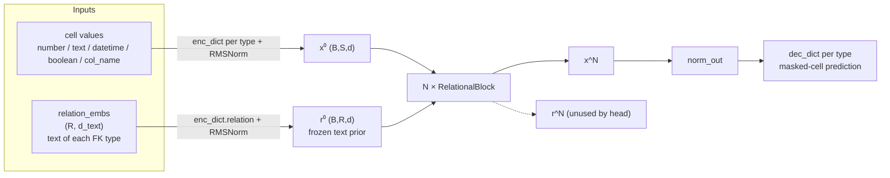
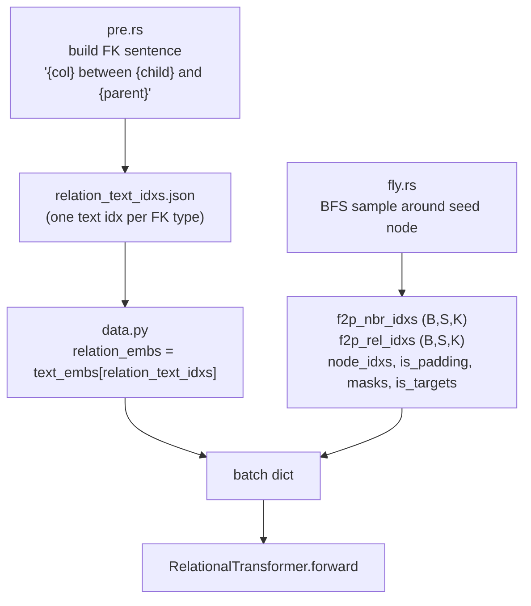
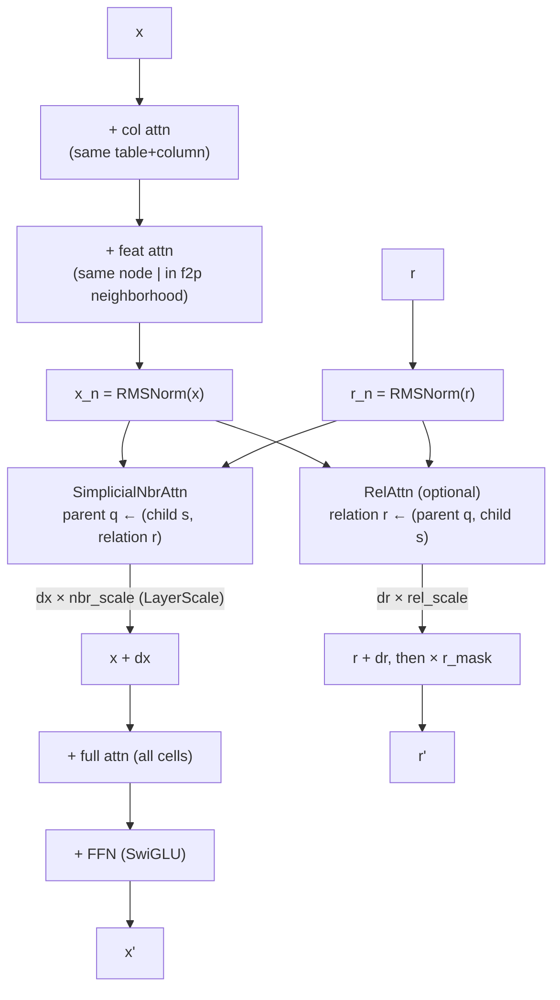
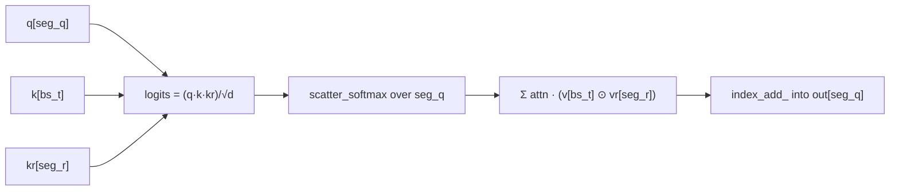

# Relation-aware simplicial attention (static text-relation route)

Zero-shot relational-table pretraining where **neighbor aggregation is conditioned
on the foreign-key type**, and each relation type is represented by the **text
embedding of its schema description** (e.g. `"director between movie and person"`).

The key empirical result on this branch: freezing that text-relation prior
(`update_relations=False`) and holding the init with a long Muon warmup gives a
zero-shot AUROC of **~0.87** on the held-out DB — well above the 0.816 target and
the previous 0.8169 record — reached in the first ~100 steps.

---

## 1. The idea in one line

Conventional neighbor attention asks *"how relevant is child `s` to parent `q`?"*.
Here the score also depends on **which relation** connects them:

```
score(q, s, r) = Σ_d  q_d · k^cell_s,d · k^rel_r,d          (per head)
value(s, r)    = v^cell_s ⊙ v^rel_r                          (FiLM-style gate)
```

`r` is a per-relation-type embedding, initialised from text and — on the winning
route — **kept frozen** through all blocks.

> Note (see `project_simplicial_diagnosis`): algebraically this is a rank-1
> DistMult/FiLM operator, not a true 2-simplex — `r` is glued to the edge and the
> softmax is segmented only by `q`. The name "simplicial" is historical.

---

## 2. Two streams

The model carries two token streams through every block:

- **`x` — cells** `(B, S, d)`: one token per (row, column) cell in the sampled subgraph.
- **`r` — relations** `(B, R, d)`: one token per foreign-key *type*, shared across
  all edges instantiating it.



Only `x` reaches the prediction head; `r` conditions `x` but is never decoded.

---

## 3. Data pipeline (leak-safe sampling)

The Rust extension (`rustler/`) builds the relation text and samples a temporal,
leak-free subgraph per seed node.



Leak prevention in `fly.rs` (validated):

| vector | mechanism | ref |
|---|---|---|
| temporal | edges with `timestamp > seed_node.timestamp` are skipped | `fly.rs:447` |
| target value | target cell gets `is_target` + `masks=True`; model uses `mask_emb` on input, value only as label | `fly.rs:528-532` |
| leaky columns | `columns_to_drop` removed from seed **and** same-timestamp nodes | `fly.rs:482-483` |
| holdout | `train_tasks` excludes `holdout_db`; val loads only the holdout artifact → zero-shot | `nanort_train.py:79-82` |

---

## 4. Inside a `RelationalBlock`



- `col`/`feat`/`full` are standard masked attentions (flex_attention).
- `SimplicialNbrAttn` updates cells; `RelAttn` updates relations.
- **`update_relations=False`** drops `RelAttn` entirely → `r` stays `r⁰` (the frozen
  text prior). This is the winning configuration.
- `nbr_scale`/`rel_scale` are per-channel LayerScale gates on the deltas
  (`simplicial_layerscale_init`, default 1.0 = plain residual).
- The relation stream is re-masked with `r_mask` after each block (defensive; the
  relation encoder has a bias).

---

## 5. Sparse edge-scatter (why it stays in memory)

Dense logits `(B, H, S, S, K)` would explode. `build_rel_batch` compiles the valid
FK slots into flat edge triples once per batch:

```
seg_q = b·S + q   (parent cell)     → gathers queries, segments softmax, scatters cell output
bs_t  = b·S + s   (child cell)      → gathers keys/values
seg_r = b·R + r   (relation type)   → gathers relation K/V, segments RelAttn
```

`SimplicialNbrAttn` then does, over the `T` edges (all `index_select`/`index_add_`,
so index traffic stays 1-D):



Per-head RMSNorm (`qk_norm`) is applied to `q`, `k`, `kr` before the triple product
to keep the trilinear logit scale from collapsing the softmax entropy.

---

## 6. SIGReg (optional geometry regularization)

`SIGReg` regularizes the per-cell hidden state after block `sigreg_layer`
(row/col views derived from `node_idxs` and the (table,col) key). Training-only
auxiliary loss: `(1-λ_row-λ_col)·L_sup + λ_row·row + λ_col·col`, trained by a
separate fp32 AdamW. Disabled by default (`sigreg_layer=None`).

---

## 7. Training recipe (the result)

| ingredient | value | why |
|---|---|---|
| relation stream | **static** (`update_relations=False`) | the dynamic `RelAttn` corrupted the text prior (one-hot, `r` norm ×4) |
| simplicial | all blocks | conditions neighbor aggregation on the clean text prior |
| optimizer | Muon (2-D weights) + AdamW (rest) | |
| **muon warmup** | **3000 steps** | holds the strong init; the model drifts off it even at tiny LR |
| checkpoint | best-by-val-AUROC | AUROC peaks early (~step 25) and decays, so the final step is not the best |

Metric: `time_to_target` = wall-clock seconds until `val/auroc_zero_shot` first
crosses **0.81621** on the held-out DB.

---

## 8. Diagnosis summary

- The text-relation prior alone carries strong zero-shot signal; the masked-cell
  reconstruction objective *degrades* it as training proceeds.
- Low LR / long warmup **slow** the decay; whether SIGReg **stops** it is under test.
- The current simplicial operator is FiLM rank-1 (redundant with the bilinear
  `feat` path); a genuine order-2 operator (free second endpoint + joint softmax)
  is the open research direction.
